<h1 align="center">☀️ TriBit Lux</h1>

<p align="center"><strong>One light. Eight levels. Three bits.</strong><br>A light-sensing experiment, told through simulations, jumper wires and PCB designs.</p>

<p align="center">
  <strong>3-bit flash ADC concept</strong> &nbsp; · &nbsp;
  <strong>LDR input</strong> &nbsp; · &nbsp;
  <strong>0–7 display</strong> &nbsp; · &nbsp;
  <strong>KiCad + EasyEDA</strong>
</p>

<p align="center">
  <a href="#v20">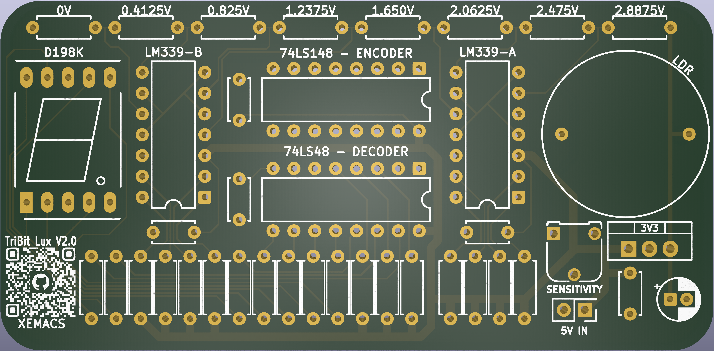</a>
  <br><sub>V2.0 · The full through-hole design · 5 V input / 3.3 V reference · Not yet fabricated</sub>
</p>

<p align="center">
  <a href="#explore">Interactive explorer</a> &nbsp; / &nbsp;
  <a href="#journey">The journey</a> &nbsp; / &nbsp;
  <a href="#signal-path">Inside the circuit</a> &nbsp; / &nbsp;
  <a href="#v20">V2.0 design gallery</a> &nbsp; / &nbsp;
  <a href="#design-files">Design files</a> &nbsp; / &nbsp;
  <a href="#roadmap">What's next</a>
</p>

**TriBit Lux** converts an LDR's output voltage into one of eight brightness levels and shows the result on a seven-segment display. It began in TinkerCAD, moved onto breadboards, and gradually transferred the encoding and display work from an Arduino to dedicated logic ICs.

This repository follows that progression through the material saved along the way: simulations, sketches, lab photographs, schematics, interactive demonstrations and PCB exports. The breadboard wiring is part of the story—getting it into a compact board was a project in itself.

> **Where the project stands:** V2.0 remains an unfabricated THT design. V2.1 is the planned hybrid THT + SMT upgrade, with threshold lights and enclosure mounting. V2.2 will document the fabricated and assembled result.

---

<a id="explore"></a>

## 🎛️ Explore the project

<p align="center">
  <a href="https://xemacs-666.github.io/TriBit-Lux/Version_2.0/assets/tribit-lux-explorer.html">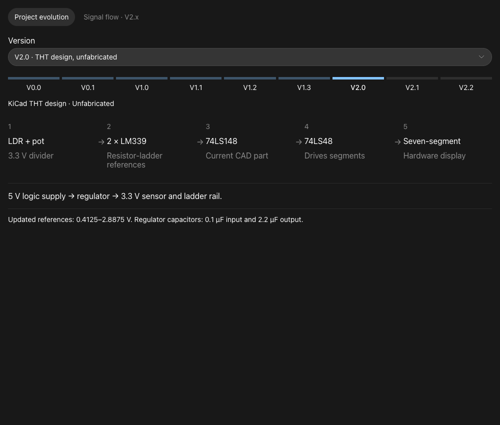</a>
</p>

<p align="center"><strong><a href="https://xemacs-666.github.io/TriBit-Lux/Version_2.0/assets/tribit-lux-explorer.html">Open the interactive TriBit Lux explorer →</a></strong></p>

| Follow the evolution | Trace a signal | Preview the next revision |
|---|---|---|
| Select a version and watch the role of the Arduino change. | Move the voltage slider and follow the comparator outputs, three encoder bits and displayed digit. | Switch to the V2.1 concept to see cumulative threshold lights. |

The preview above is animated; the linked page is interactive. The explorer uses the updated V2.0 reference mapping, including the level-0 band. It models ideal logic, with real-world tolerances, noise and timing left out. [Open the standalone HTML file](Version_2.0/assets/tribit-lux-explorer.html).

<a id="journey"></a>

## 🧭 From simulation to copper

| Chapter | Version | What changed |
|---|---|---|
| **Simulate** | [V0.0](#v00) → [V0.1](#v01) | A potentiometer becomes an LDR; the comparator front end takes shape. |
| **Build** | [V1.0](#v10) | The circuit moves onto a breadboard with an Arduino Nano. |
| **Move into hardware** | [V1.1](#v11) → [V1.2](#v12) | The priority encoder and then the display decoder become dedicated ICs. |
| **Observe** | [V1.3](#v13) | An LCD adds a window into the sensor voltage. |
| **Design the board** | [V2.0](#v20) | The breadboard connections become a through-hole KiCad design. |
| **Refine and fabricate** | [V2.1 → V2.2](#roadmap) | Planned hybrid layout, threshold lights, acrylic enclosure and physical board. |

---

<a id="v00"></a>

## 🧪 V0.0 · Starting with a knob

**TinkerCAD simulation · Potentiometer input · Arduino Uno**

The first version used a potentiometer to stand in for the sensor voltage. Turning the knob changed the input to the comparator bank, while the Uno performed priority encoding and drove the seven-segment display. This established the basic voltage-to-level idea before adding a light-sensitive input.

[](https://www.tinkercad.com/things/60Tk7pVbgVW-tribit-lux-v00?sharecode=bsW5T545n6U2o7TxL7Ta_quI-Dl-KoERqczIX1Q8Fq4)

*The starting point. Click the circuit image to open its TinkerCAD simulation.*

**Open this version:** [Simulation](https://www.tinkercad.com/things/60Tk7pVbgVW-tribit-lux-v00?sharecode=bsW5T545n6U2o7TxL7Ta_quI-Dl-KoERqczIX1Q8Fq4) · [Schematic PDF](Version_0.0/schematic/Tribit%20Lux%20V0.0.pdf) · [Arduino sketch](Version_0.0/firmware/tribit_lux_v0_00/tribit_lux_v0_00.ino) · [BOM](Version_0.0/bom/bom.csv)

<a id="v01"></a>

## 🌤️ V0.1 · Let there be light

**TinkerCAD simulation · LDR input · LM339 comparators**

The potentiometer input was replaced with an LDR, and the comparator section moved to LM339 devices. Now the input responded to light. The Uno still supplied both digital stages: deciding the encoded value and converting it into segment signals.

[](https://www.tinkercad.com/things/gNVAR2cQYVG-tribit-lux-v01?sharecode=9jLX_zzwRAG0_mHYH1R4YNfyqPdioSTKhPsh0a257ho)

*The sensor enters the picture. The display logic is still handled by the Uno.*

**Open this version:** [Simulation](https://www.tinkercad.com/things/gNVAR2cQYVG-tribit-lux-v01?sharecode=9jLX_zzwRAG0_mHYH1R4YNfyqPdioSTKhPsh0a257ho) · [Schematic PDF](Version_0.1/schematic/Tribit%20Lux%20V0.1.pdf) · [Arduino sketch](Version_0.1/firmware/tribit_lux_v0_01/tribit_lux_v0_01.ino) · [BOM](Version_0.1/bom/bom.csv)

---

<a id="v10"></a>

## 🔌 V1.0 · The first breadboard

**Physical prototype · Two LM339s · Arduino Nano**

The LDR and comparator bank moved out of the simulator and onto a breadboard. The Nano read the comparator outputs and drove the seven-segment display. The saved recording captures the early physical build, with the jumper wiring fully on show.

<p align="center">
  <a href="Version_1.0/assets/TriBitLux_V1_0%202026-10-06%20at%2023.10.18.mp4">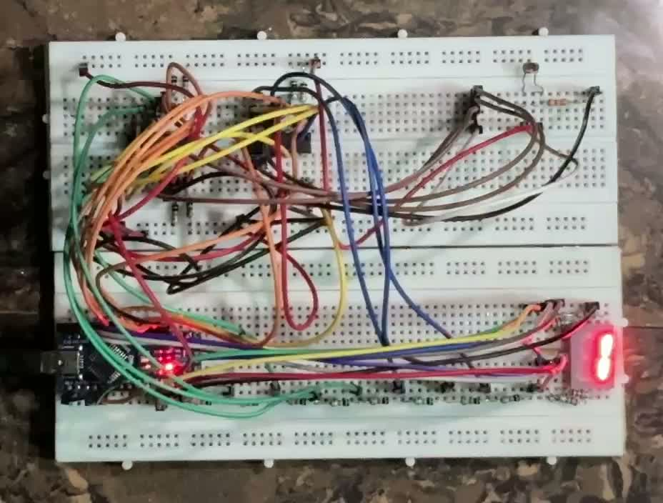</a>
  <br><strong><a href="Version_1.0/assets/TriBitLux_V1_0%202026-10-06%20at%2023.10.18.mp4">▶ Watch the breadboard recording · 24 seconds</a></strong>
</p>

### A closer look at the display pins

[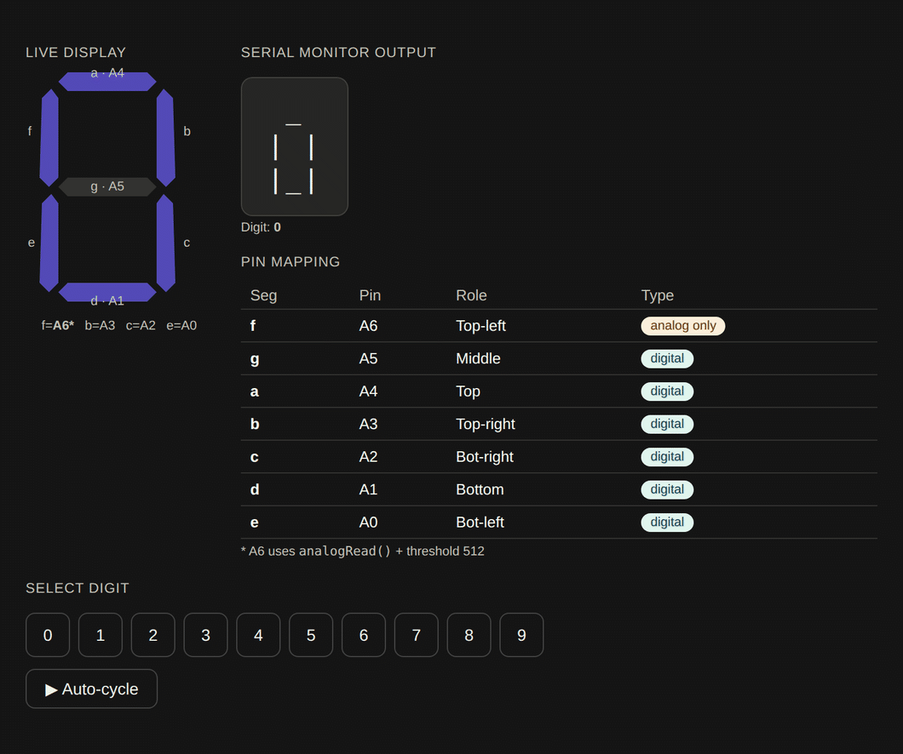](https://xemacs-666.github.io/TriBit-Lux/Version_1.0/assets/TriBitLux_V1_0_pin_visualizer.html)

*Click the animation to explore the display pin layout.*

**Open this version:** [Recording](Version_1.0/assets/TriBitLux_V1_0%202026-10-06%20at%2023.10.18.mp4) · [Interactive pin guide](https://xemacs-666.github.io/TriBit-Lux/Version_1.0/assets/TriBitLux_V1_0_pin_visualizer.html) · [HTML source](Version_1.0/assets/TriBitLux_V1_0_pin_visualizer.html) · [Visualizer sketch](Version_1.0/firmware/TriBitLux_V1_0_visualizer/TriBitLux_V1_0_visualizer.ino)

The saved visualizer sketch is a debugging aid; it is not the complete original V1.0 display firmware.

<a id="v11"></a>

## 🧠 V1.1 · Giving the encoder its own IC

**Physical prototype · 74F148 priority encoder · EasyEDA design exports**

The 74F148 took over priority encoding from the Nano. The comparator bank now fed a dedicated logic IC, which produced the three output bits. The Nano continued to decode those bits and drive the display. This version also has an EasyEDA schematic and PCB design archive.

### At the workbench

| Schematic beside the build | Full demonstration setup |
|:---:|:---:|
| [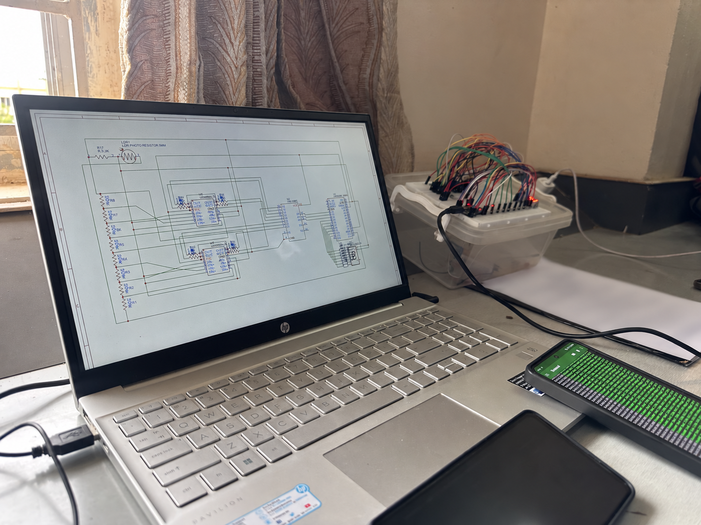](Version_1.1/assets/TriBitLux_V1_1_3132.JPG) | [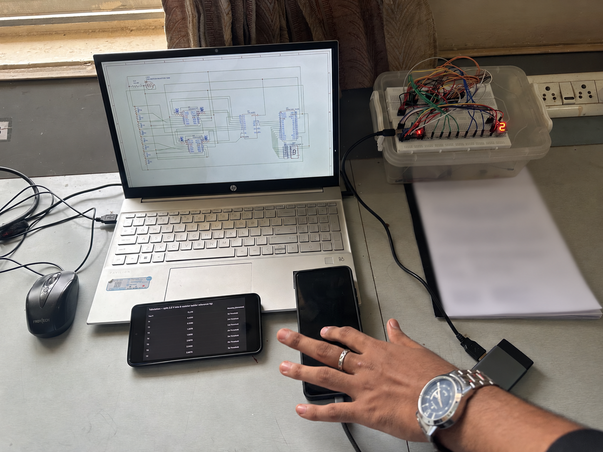](Version_1.1/assets/TriBitLux_V1_1_3134.JPG) |
| **Schematic and wiring together** | **Display and reference table** |

| Watching the output | Another angle of the setup |
|:---:|:---:|
| [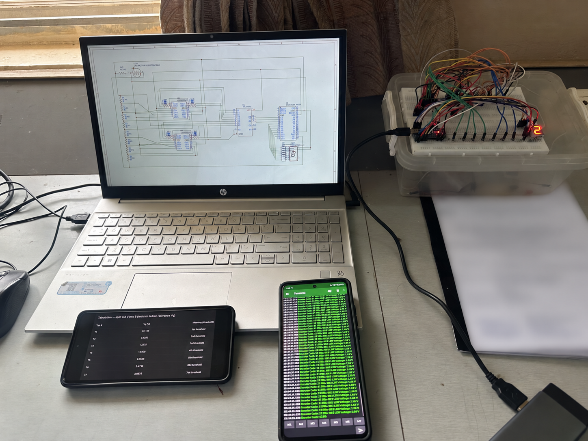](Version_1.1/assets/TriBitLux_V1_1_3135.JPG) | [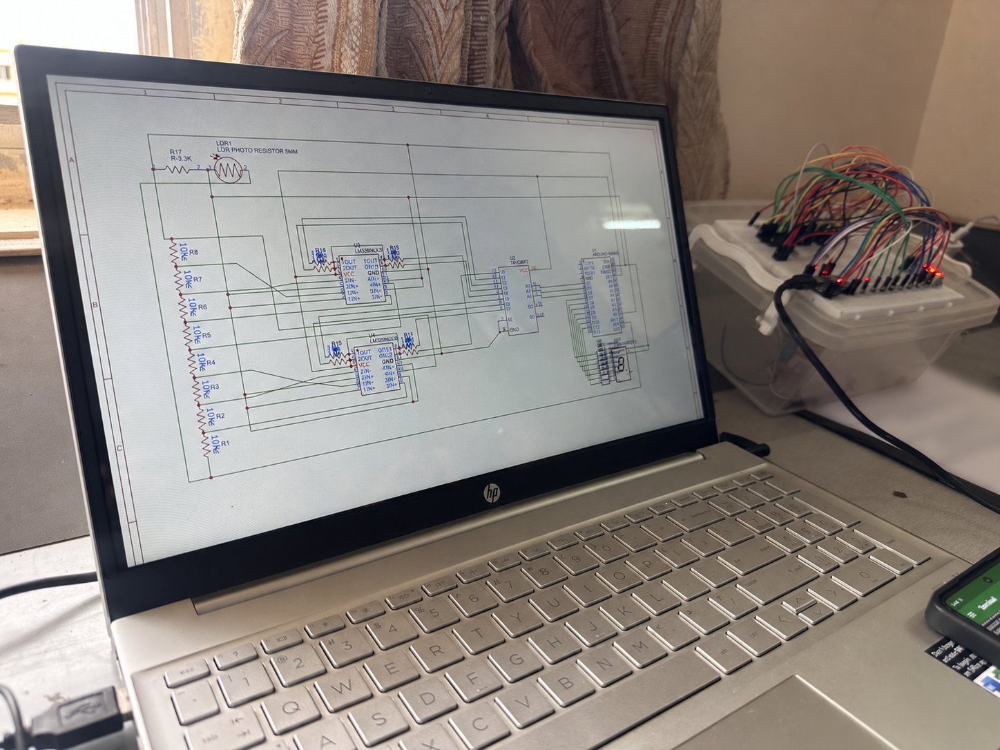](Version_1.1/assets/TriBitLux_V1_1_3136.JPG) |
| **Hardware output alongside monitoring** | **The complete workbench arrangement** |


### From connections to a board design

| Schematic | Routed PCB layout |
|:---:|:---:|
| [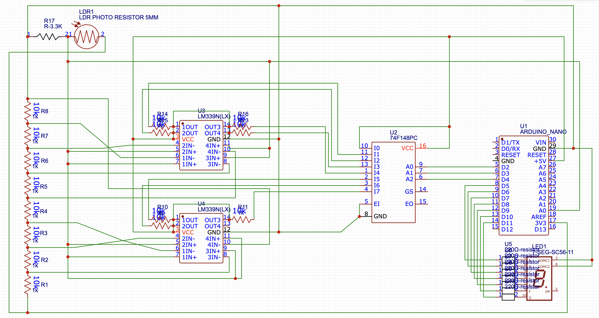](Version_1.1/schematic/Schematic_TriBitLux_V1_1-LIC_2026-10-06.pdf) | [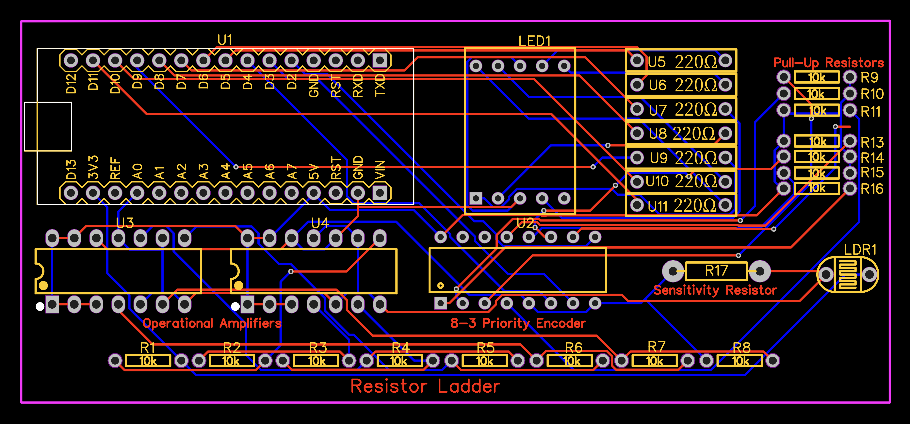](Version_1.1/assets/PCB_PCB_TriBit_Version_1_1-LIC_2_2026-10-08.png) |

<p align="center">
  <a href="Version_1.1/pcb/TriBitLux_V1_1.jpeg">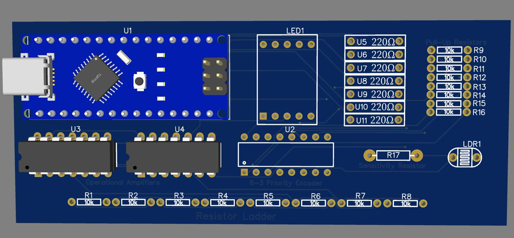</a>
  <br><sub>EasyEDA design render with the Nano fitted. This image documents the board design.</sub>
</p>

| Top board view · SVG | Bottom board view · SVG |
|:---:|:---:|
| [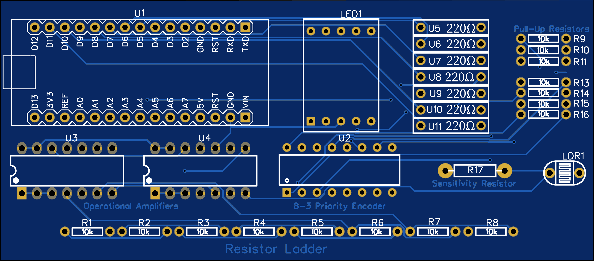](Version_1.1/pcb/TriBitLux_V1_1_Top.svg) | [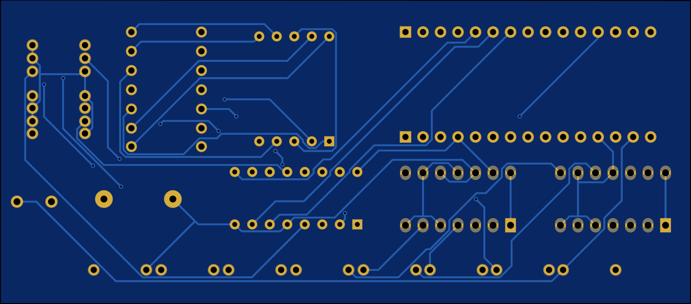](Version_1.1/pcb/TriBitLux_V1_1_Bottom.svg) |

**Open this version:** [Schematic PDF](Version_1.1/schematic/Schematic_TriBitLux_V1_1-LIC_2026-10-06.pdf) · [PCB PDF](Version_1.1/pcb/PCB_PCB_TriBitLux_V1_1-LIC_2_2026-10-06.pdf) · [Arduino sketch](Version_1.1/firmware/TriBitLux_V1_1_LIC/TriBitLux_V1_1_LIC.ino) · [BOM](Version_1.1/bom/BOM_TriBitLux_V1_1-LIC_2026-10-06.csv) · [Gerber archive](Version_1.1/gerbers/Gerber_TriBitLux_V1_1-LIC_PCB_TriBitLux_V1_1-LIC_2_2026-10-06.zip)

<details>
<summary><strong>Browse the individual EasyEDA layer PDFs</strong></summary>

| Export | Top | Bottom |
|---|---|---|
| Copper | [Top layer](Version_1.1/pcb/PCB_PCB_TriBitLux_V1_1-LIC_2_2026-10-06/TopLayer.pdf) | [Bottom layer](Version_1.1/pcb/PCB_PCB_TriBitLux_V1_1-LIC_2_2026-10-06/BottomLayer.pdf) |
| Silkscreen | [Top silk](Version_1.1/pcb/PCB_PCB_TriBitLux_V1_1-LIC_2_2026-10-06/TopSilkLayer.pdf) | [Bottom silk](Version_1.1/pcb/PCB_PCB_TriBitLux_V1_1-LIC_2_2026-10-06/BottomSilkLayer.pdf) |
| Solder mask | [Top mask](Version_1.1/pcb/PCB_PCB_TriBitLux_V1_1-LIC_2_2026-10-06/TopSolderMaskLayer.pdf) | [Bottom mask](Version_1.1/pcb/PCB_PCB_TriBitLux_V1_1-LIC_2_2026-10-06/BottomSolderMaskLayer.pdf) |
| Paste mask | [Top paste](Version_1.1/pcb/PCB_PCB_TriBitLux_V1_1-LIC_2_2026-10-06/TopPasteMaskLayer.pdf) | [Bottom paste](Version_1.1/pcb/PCB_PCB_TriBitLux_V1_1-LIC_2_2026-10-06/BottomPasteMaskLayer.pdf) |

[Board outline](Version_1.1/pcb/PCB_PCB_TriBitLux_V1_1-LIC_2_2026-10-06/BoardOutLine.pdf) · [Holes](Version_1.1/pcb/PCB_PCB_TriBitLux_V1_1-LIC_2_2026-10-06/Hole.pdf) · [Multi-layer](Version_1.1/pcb/PCB_PCB_TriBitLux_V1_1-LIC_2_2026-10-06/Multi-Layer.pdf) · [Document layer](Version_1.1/pcb/PCB_PCB_TriBitLux_V1_1-LIC_2_2026-10-06/Document.pdf)

</details>

---

<a id="v12"></a>

## 🔢 V1.2 · Hardware takes over the display

**Physical prototype · 74LS48 decoder · Serial monitoring**

Adding the 74LS48 completed the dedicated hardware display path: comparator bank → encoder → decoder → seven-segment display. The Nano supplied 5 V and received the three encoder bits so the serial console could show them for assurance.

### The wiring, up close

| Overhead wiring view | Sensor and jumper connections |
|:---:|:---:|
| [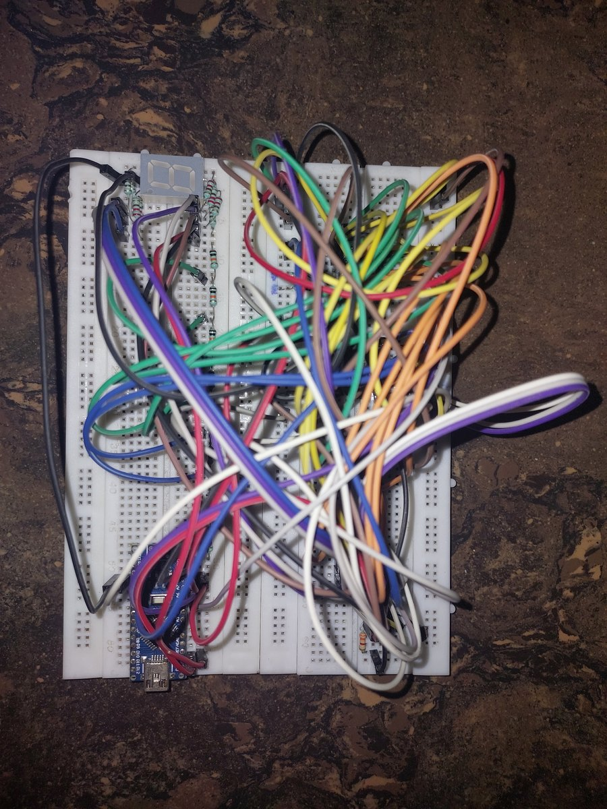](Version_1.2/assets/TriBitLux_V1_2_135115.jpg) | [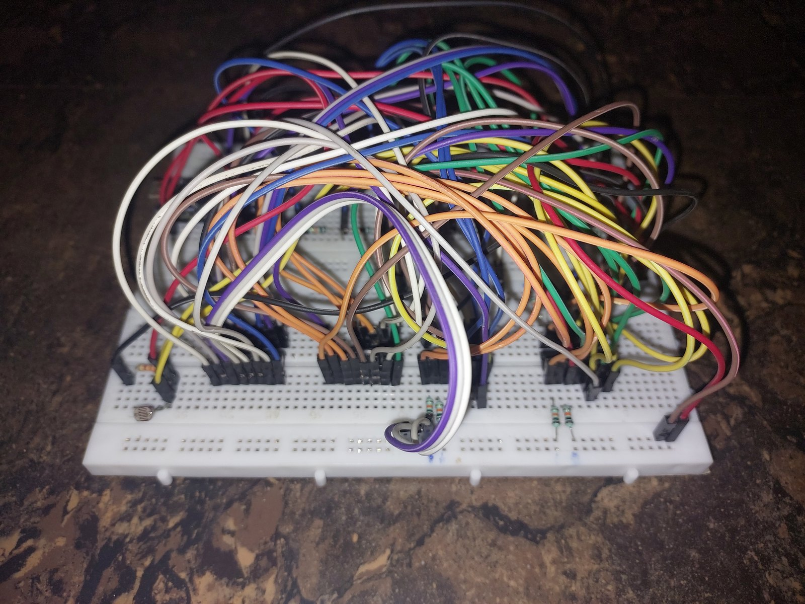](Version_1.2/assets/TriBitLux_V1_2_135217.jpg) |

<p align="center">
  <a href="Version_1.2/assets/TriBitLux_V1_2_140313.jpg">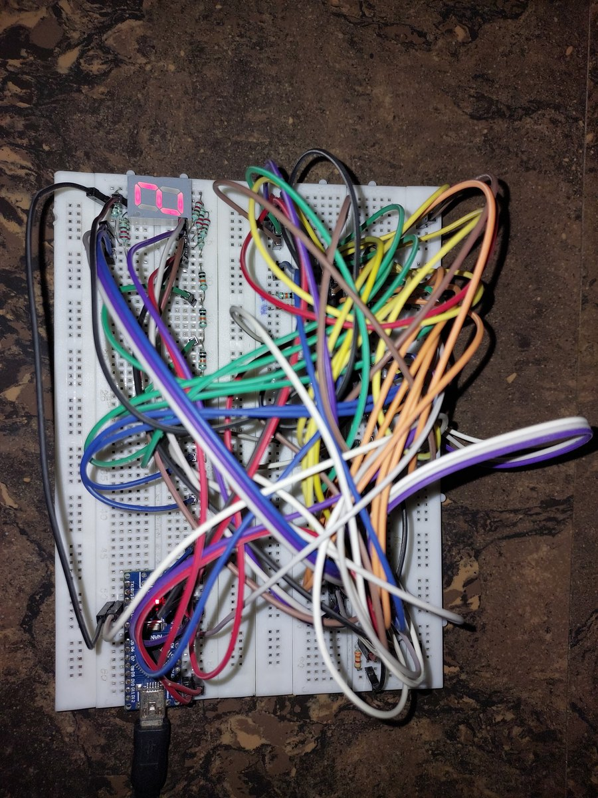</a>
  <br><sub>The powered build. The photographed display is driven by the 74LS48.</sub>
</p>

| Additional powered view | A second captured state |
|:---:|:---:|
| [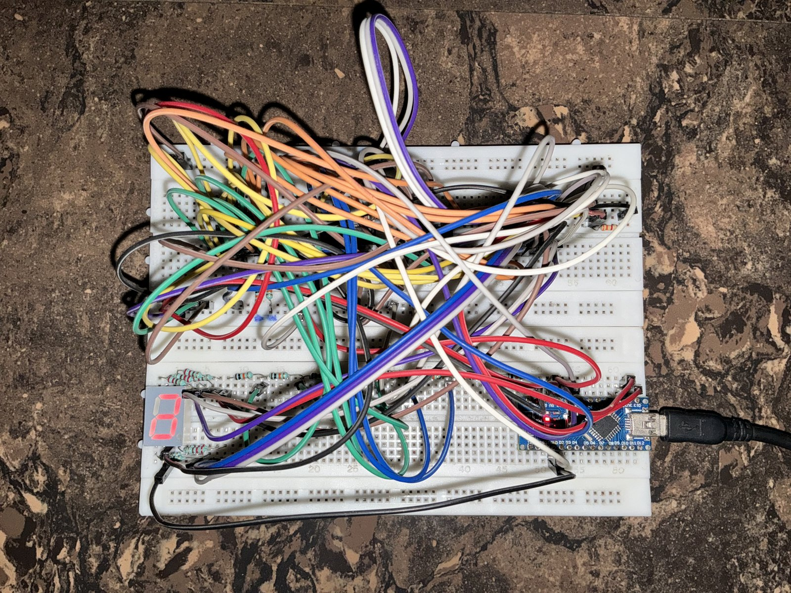](Version_1.2/assets/TriBitLux_V1_2_0733.heic) | [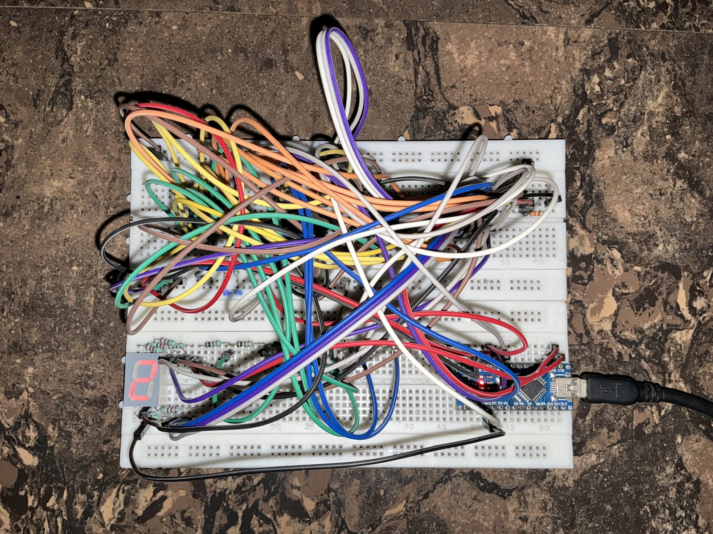](Version_1.2/assets/TriBitLux_V1_2_0734.heic) |

*The last two previews link to the original HEIC photographs. Large photographs throughout this page use smaller preview copies; click them for the originals.*

**Open this version:** [Serial-monitor sketch](Version_1.2/firmware/TriBitLux_V1_2_LIC/TriBitLux_V1_2_LIC.ino) · [Original photo collection](Version_1.2/assets/)

The saved sketch includes experimental segment-driving code. In the photographed build, the **74LS48 drives the display**, while the Nano observes the encoder output.

<a id="v13"></a>

## 📟 V1.3 · A window into the sensor voltage

**Physical prototype · 16×2 I²C LCD · Parallel monitoring**

The Nano gained another role: driving an LCD to make the working flow easier to follow. The hardware seven-segment path remained in place, while the Nano supplied power and sampled the LDR voltage through its own ADC.

| LCD-equipped breadboard | Another view of the build |
|:---:|:---:|
| [](Version_1.3/assets/TriBitLux_V1_3_%281%29.jpg) | [](Version_1.3/assets/TriBitLux_V1_3_%282%29.jpg) |

### Explore the LCD demonstration

[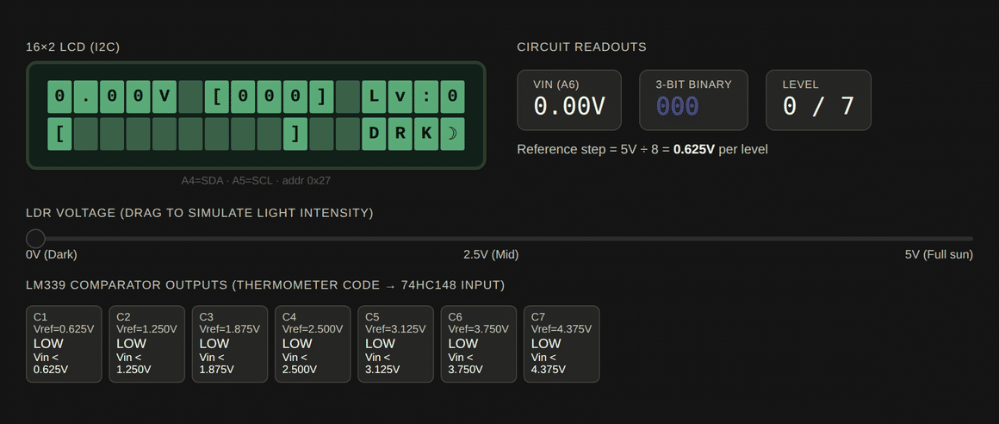](https://xemacs-666.github.io/TriBit-Lux/Version_1.3/assets/TriBitLux_V1_3_%285V%29.html)

| 5 V demonstration | 3.3 V demonstration |
|:---:|:---:|
| [**Open interactive 5 V view →**](https://xemacs-666.github.io/TriBit-Lux/Version_1.3/assets/TriBitLux_V1_3_%285V%29.html) | [**Open interactive 3.3 V view →**](https://xemacs-666.github.io/TriBit-Lux/Version_1.3/assets/TriBitLux_V1_3_%283.3V%29.html) |
| [HTML source](Version_1.3/assets/TriBitLux_V1_3_%285V%29.html) | [HTML source](Version_1.3/assets/TriBitLux_V1_3_%283.3V%29.html) |

The LCD firmware calculates its own level from the analog voltage; it **does not read the encoder bits**. That makes the LCD useful for observing the input, while the hardware display follows the comparator and encoder chain. These saved demonstrations belong to the V1.3 archive; the main explorer shows the updated V2.0 logic model.

**Open this version:** [LCD sketch](Version_1.3/firmware/TriBitLux_V1_3/TriBitLux_V1_3.ino) · [Original assets](Version_1.3/assets/)

---

<a id="v20"></a>

## 🟢 V2.0 · From jumper wires to copper traces

**KiCad design · Through-hole components · Unfabricated**

V2.0 brings the circuit into KiCad as an editable schematic and PCB. The design includes a 20 mm LDR, a potentiometer for adjusting the response, local decoupling capacitors and a regulated 3.3 V rail for the sensor divider and reference ladder.

| Sensor | Adjustment | Power and references | Construction |
|---|---|---|---|
| 20 mm LDR | Potentiometer in the divider | 5 V logic; 3.3 V sensor and ladder | Through-hole board |

### The board, four ways

<p align="center">
  <a href="Version_2.0/assets/TriBitLux_V2_0_Top_Components.png">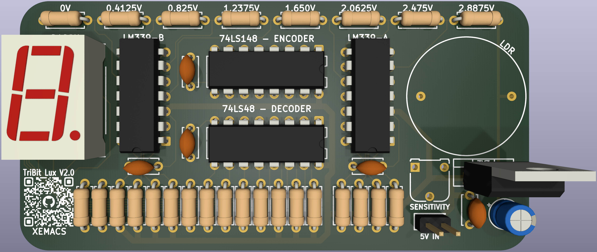</a>
  <br><sub>Component-populated CAD preview. The LDR and potentiometer have no visible models in this render; both remain in the design and BOM.</sub>
</p>

| Read the board | Follow the routing |
|:---:|:---:|
| [](Version_2.0/assets/TriBitLux_V2_0_Top.png) | [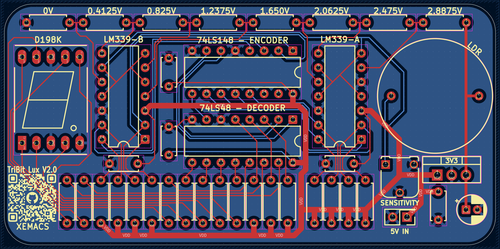](Version_2.0/assets/TriBitLux_V2_0.png) |
| **Top · Silkscreen and placement** | **Layout · Copper and connections** |

<p align="center">
  <a href="Version_2.0/assets/TriBitLux_V2_0_Bottom.png">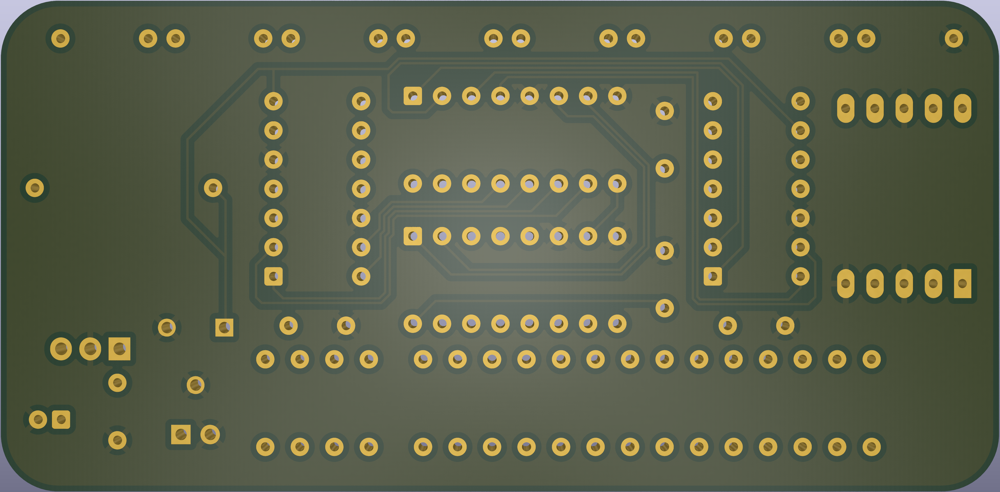</a>
  <br><sub>Underside of the saved PCB design. All board images here are CAD views, not fabricated hardware.</sub>
</p>

### Read the silkscreen

| Printed label | Circuit reference | Purpose |
|---|---|---|
| **LM339-A** | U1 | Upper threshold comparators plus the ground-reference comparator |
| **LM339-B** | U2 | Lower threshold comparators, from 0.4125 V to 1.650 V |
| **74LS148 – ENCODER** | U3 | Converts active comparator inputs into three bits |
| **74LS48 – DECODER** | U4 | Drives the seven-segment display |
| **D198K** | U5 | Displays the selected level |
| **LDR / SENSITIVITY** | R9 / RV1 | Light input and divider adjustment |
| **3V3 / 5V IN** | U6 / J2 | Regulated reference supply and external power input |
| **0 V → 2.8875 V** | R8 → R1, left to right | Nominal lower-voltage end of each 10 kΩ ladder resistor |

The ladder labels identify nominal nodes, not voltage drops across the resistors. Each resistor spans 0.4125 V ideally; the far end of R1 reaches 3.3 V. Circuit references remain in the editable design and parts lists.

The current revision includes revised capacitor footprints, a 15.5 mm lead pitch for the 20 mm LDR, a repository QR graphic, and XEMACS attribution. The custom capacitor and QR footprints are included in the project library.

### Schematic · current source export

[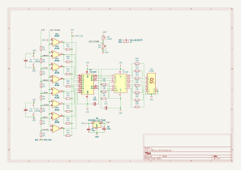](Version_2.0/schematic/TriBit_Lux_V2_0_Schematics.pdf)

*Click for the PDF, or open the [scalable SVG](Version_2.0/assets/TriBitLux_V2_0.svg). The [older PNG export](Version_2.0/assets/TriBit_Lux_V2_0_Schematics.png) is retained as an earlier snapshot.*

### Design checkpoint · 19 October 2026

| Check | Result |
|---|---|
| KiCad PCB DRC | 0 reported violations; 0 unconnected items |
| Schematic ↔ PCB parity | 0 reported mismatches |
| Schematic ERC | 0 reported violations |
| BOM / placement coverage | 41 components; refreshed JLCPCB-format exports |
| Fabrication / assembly | Not performed; supplier selection and final export review remain open |

These results use the project's configured rules. Some footprint/courtyard checks are disabled; this is not a manufacturer DFM approval. See the [review and remaining work](Version_2.0/review/README.md) for the exact limits and open items.

<a id="signal-path"></a>

### Inside the circuit

```text
                         3.3 V reference ladder
                                  │
Light → LDR + potentiometer → LM339 comparators → Priority encoder → 74LS48 → 0–7
         sensor voltage          parallel decisions     three bits       display
```

| Stage | What happens |
|---|---|
| **1 · Sense** | Light lowers the LDR resistance. In the current divider arrangement, the sensor voltage rises as the LDR resistance falls. |
| **2 · Compare** | Seven nonzero ladder references divide the nominal 0–3.3 V range into eight bands, spaced by 0.4125 V. |
| **3 · Encode** | The highest-priority active LOW input determines the output. I7 through I1 receive thresholds from 0.4125 V up to 2.8875 V; I0 uses the eighth comparator with its ground reference on the opposite input. |
| **4 · Display** | Encoder outputs S0, S1 and S2 connect to decoder inputs A, B and C. D is grounded, keeping the displayed range at 0–7. |

The comparator and logic ICs use **5 V**. The sensor divider and reference ladder use the regulated **3.3 V** rail. Earlier breadboards used a **74F148**; the current V2.0 CAD source specifies a **74LS148**.

> **About the number on the display:** it is a relative brightness level, not calibrated lux. The LDR, potentiometer setting and component tolerances influence the physical transition points.

<a id="design-files"></a>

### Open the V2.0 design

| Resource | Direct links |
|---|---|
| **KiCad source** | [Project](Version_2.0/TriBitLux_V2_0/TriBitLux_V2_0.kicad_pro) · [Schematic](Version_2.0/TriBitLux_V2_0/TriBitLux_V2_0.kicad_sch) · [PCB](Version_2.0/TriBitLux_V2_0/TriBitLux_V2_0.kicad_pcb) |
| **Schematic exports** | [PDF](Version_2.0/schematic/TriBit_Lux_V2_0_Schematics.pdf) · [Current SVG](Version_2.0/assets/TriBitLux_V2_0.svg) · [Earlier PNG](Version_2.0/assets/TriBit_Lux_V2_0_Schematics.png) · [Netlist](Version_2.0/schematic/TriBitLux_V2_0.net) |
| **Parts lists** | [BOM](Version_2.0/bom/TriBitLux_V2_0_BOM.csv) · [JLCPCB BOM](Version_2.0/bom/TriBitLux_V2_0-BOM-JLCPCB.csv) |
| **Placement exports** | [Top](Version_2.0/cpl/TriBitLux_V2_0-top-pos.csv) · [Bottom](Version_2.0/cpl/TriBitLux_V2_0-bottom-pos.csv) · [JLCPCB top](Version_2.0/cpl/TriBitLux_V2_0-top-pos-JLCPCB.csv) |
| **Manufacturing snapshot · JLCONE pass reported** | [Gerber ZIP](Version_2.0/Gerber/gerber.zip) |
| **Custom footprints** | [Project library](Version_2.0/TriBitLux_V2_0/TriBitLux.pretty/) · [Library table](Version_2.0/TriBitLux_V2_0/fp-lib-table) |
| **Review** | [Checks and remaining work](Version_2.0/review/README.md) |
| **Interactive documentation** | [Live explorer](https://xemacs-666.github.io/TriBit-Lux/Version_2.0/assets/tribit-lux-explorer.html) · [Standalone HTML](Version_2.0/assets/tribit-lux-explorer.html) · [GIF preview](Version_2.0/assets/tribit-lux-preview.gif) |

Open `TriBitLux_V2_0.kicad_pro` in KiCad to work with the schematic and PCB together. The editable files are the design sources. The JLCPCB CSVs now reflect the current component list and saved placement export. Blank supplier codes require part selection; retained codes are historical selections that still need verification. XEMACS reports that the KiCad export passed all JLCONE checks. Preserve the exact checked archive; regenerate it after any further manufacturing-layer changes. A later PCB save timestamp alone does not establish that the archive is stale.

---

<a id="roadmap"></a>

## 🚧 What's next

| **V2.0 · Preserve** | **V2.1 · Refine** | **V2.2 · Build** |
|---|---|---|
| Keep the full THT design as an unfabricated milestone. | Develop the hybrid THT + SMT revision. | Fabricate and assemble the completed design. |
| Retain its schematic, layout and development record. | Add threshold indicator lights, visual refinements and mounting holes. | Record power-up measurements, light response and the finished assembly. |
| **Current design archive** | Plan dimensions and standoffs for a custom acrylic case. | Fit the enclosure and document the physical result. |

The planned lights should make each level transition easier to see. The acrylic enclosure should make the circuit easier to display while providing secure mounting. Support components such as decoupling and protection remain electrically important whether their packages are THT or SMT.

<a id="repository"></a>

## 📂 Finding your way around

```text
TriBit-Lux/
├── README.md                    The illustrated project walkthrough
├── docs/media/                  Lightweight photo previews and video poster
├── Version_0.0/                 Potentiometer simulation
├── Version_0.1/                 LDR simulation
├── Version_1.0/                 First breadboard, video and pin visualizer
├── Version_1.1/                 Encoder build and EasyEDA design archive
├── Version_1.2/                 Hardware decoder build and serial sketch
├── Version_1.3/                 LCD build and interactive demonstrations
└── Version_2.0/
    ├── TriBitLux_V2_0/          Editable KiCad project, schematic and PCB
    ├── schematic/              PDF and netlist
    ├── assets/                 Renders, explorer and animated preview
    ├── bom/                    Parts lists
    ├── cpl/                    Placement exports
    ├── review/                 Check results and remaining release work
    └── Gerber/                 Existing manufacturing snapshot
```

Each version folder contains the records that survived that stage. Older versions may not contain a complete build package. The photographs, videos and interactive pages show the development process; the editable design files describe the circuit. KiCad temporary files and backups are excluded through `.gitignore`.

<p align="center"><strong>Built and documented by XEMACS</strong><br>From a simulated input to a board designed around light.<br><br><a href="#explore">Try the explorer</a> · <a href="#journey">Back to the journey</a> · <a href="https://github.com/XEMACS-666/TriBit-Lux">Repository</a></p>
